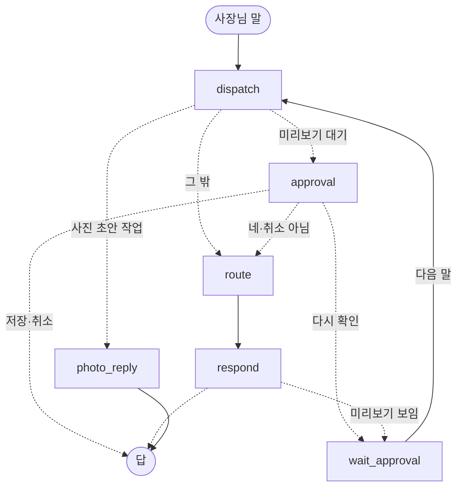

# Part A · 사장님 비서 (`agent/` + `tools/`)

- 담당: 노종현, 노근형
- 하는 일: 사장님 한마디 → 의도 파악 → 플레이스 기능 매칭 → tool 호출 → 결과 정리. 대표 기능 3개(메뉴 사진 등록, 리뷰 요약, 통계 리포트)는 실제 입력까지 한다.
- `agent/`: LangGraph 그래프, 프롬프트, 서브에이전트. `tools/`: tool 함수와 더미 플레이스 API.
- 쓸 수 있는 것: `agenthan.core.*`. Part B·C 내부(`agenthan.rag.*`, `agenthan.voice.*`)는 import하지 않는다.
- 가게 지식은 `StoreKnowledge`로 받는다. 진짜 구현 전에는 `core.fakes.FakeStoreKnowledge.from_fixture()`.
- 자세한 요구사항: `docs/PRD.md` §6.1 · 리서치: `docs/research/01-agent-hcx-langgraph.md` · CLOVA 호출·LangGraph 예제: `docs/sdk.md` 3장, 부록 B-3·B-6

## 지금 구현된 것 (PRD v0.2 기준 위치)

```
사장님 발화
 → OwnerAssistant (agent/owner_assistant.py)
     ⓪ 상태 규칙: 메뉴 사진 초안, 승인 대기(네/취소), 용어 사전, 직전 리포트 후속 질문
     ① 기능 후보: agent/place_matcher.py rank_features 상위 5개, 임계값 없음 (키워드 30% + 임베딩 70%)
     ② 기능 하나 고르기: agent/feature_selector.py — HCX-DASH-002 select_feature 강제 호출
        (후보 + none + clarify). 되묻는 중이면 그 기능과 직전 질문을 함께 준다.
        열린 작업이 있으면 같은 호출에서 act(answer/edit/resume/new)도 받는다(추가 호출 없음).
        보류한 작업의 기능은 후보에 늘 남긴다. DASH가 실패하면 예전 규칙(임계값 0.48 넘는 1위)
     ③ 대표 기능 위임 또는 그 기능 도구만 붙여 HCX-005 실행
        (그 기능의 짧은 절차·예시와, 예약·주문·톡톡이면 코드가 좁힌 대상 후보만 함께 준다)
        ├ menu                    → upsert_menu (tools/feature_tools.py, 등록·수정·삭제·품절, 더미 저장)
        ├ 메뉴판·음식 사진          → ask_photo(): 사진 분류 → 초안 → 사장님 승인 → 저장
        ├ review → 리뷰 서브에이전트 (agent/review_delegate.py → agent/review/)
        ├ statistics (A-3, R2)    → R1 facts → 해석 규칙 → 도구 없는 HCX-005 문장화/템플릿
        └ 그 밖의 14개 기능          → 그 기능 도구 하나 (tools/feature_tools.py)
     ④ 쓰기 도구(메뉴 포함 10개)는 저장소 사본에 미리 실행 → "네"에만 실제 저장, "취소"는 버림.
        조회 도구 5개(통화 기록·네이버페이 안내·정산·POS·도움말)는 바로 실행
```

| 위치 | 하는 일 |
|---|---|
| `agent/owner_assistant.py` | 오케스트레이터 대화 루프 (CLI: `python -m agenthan.agent.owner_assistant`) |
| `agent/food_photo.py` | 음식 사진 분류·AI 메뉴 추측·배경 제거 연결 |
| `agent/menu_photo.py` | A-1 메뉴 사진 → 초안: HCX-005 사진 읽기 → 가게 지식(`StoreKnowledge`) 대조 → 한국어 이름·설명 |
| `agent/place_matcher.py`, `place_features.json` | 플레이스 기능 카탈로그(=PRD의 `features.json`)와 후보 순위 |
| `agent/feature_selector.py` | HCX-DASH-002 `select_feature`로 후보 중 기능 하나와 열린 작업에 대한 act 고르기 |
| `agent/task_ledger.py` | 세션 작업 원장: 작업 스택(보류·재개), 승인 대기 미리보기, 값(slot)과 출처·변경 이력 |
| `agent/value_source.py` | 값 출처 게이트와 사장님 말로 대상 레코드 후보 좁히기 |
| `agent/feature_guides.json` | 쓰기 기능별 짧은 판단 순서와 대표 예시(선택된 기능 것만 프롬프트에 넣음) |
| `agent/review/` | 리뷰 서브에이전트: 분석·요약, 미답글, 답글 초안·등록(더미), 정기 보고 루틴(A-2·A-4) |
| `agent/review_delegate.py` | 오케스트레이터 → 리뷰 서브에이전트 위임 |
| `agent/report_explainer.py` | A-3 통계 해석 문장화·숫자 검증·실패 시 코드 템플릿 (`ReportAnswer`) |
| `tools/place_report.py`, `place_report_data.json` | R1 로컬 더미 통계 계산 (`ReportFacts`) |
| `tools/report_insights.py` | R2 가게 정보와 통계를 연결하는 해석 규칙, 우선순위 상위 3개 |
| `tools/dummy_store.py` | 더미 플레이스 API (로컬 `.agenthan/store.json`, 실제 네이버 연동 없음) |
| `tools/feature_tools.py` | 17개 기능 도구(기능당 하나)와 조회 전용 도구 목록. 도구별 용도·인자는 [`docs/tools.md`](../../../docs/tools.md) |
| `tools/review_clf/` | 리뷰 [특징] 분류기 (`models/baseline.joblib`은 실제 리뷰로 학습해 레포에 없음 · 카톡으로 받기) |
| `tools/knowledge_adapters.py` | `StoreKnowledge`(Part B 계약) → 리뷰 서브에이전트의 리뷰·메뉴 입력 |
| `tools/review_adapters.py` | 더미 플레이스 API → 리뷰 서브에이전트 입력 |
| `tools/image_cutout.py` | M1a 음식 사진 배경 제거 → 흰 배경 정사각형 바이트 (음식 사진 등록에 연결) |
| `eval/run.py`, `eval/flow.py`, `eval/gate.py` | [기능 매칭·전체 흐름 평가, 재생·기준선·회귀 게이트](../eval/README.md) |

공통 HCX 클라이언트는 `core/llm.py`, 임베딩은 `core/embedding.py`를 쓴다.

### 대화 의미 → 작업 원장 (act)

열린 작업(진행 중이거나 보류한 도구 작업)이 있을 때만 `select_feature`에 `act`를 붙이고
열린 작업 요약을 시스템에 넣는다. 열린 작업이 없으면 요청은 예전과 같다. 모델은 제안만 하고
코드가 원장과 대조해 반영한다. act만으로 저장하거나 승인을 만들지 않는다.

| act | 예 | 코드가 하는 일 |
|---|---|---|
| `answer` | `8500원` | 진행 중인 작업에 이어 HCX-005 호출 (예전과 같음) |
| `edit` | `아니, 금요일만` | 같은 기능의 미리보기를 무효로 하고, 고친 항목만 바꾸게 안내 |
| `new` | `그건 두고 전화부터 보여 줘` | 지금 작업은 보류(원장 스택), 새 기능 처리 후 보류 작업 재개 안내 |
| `resume` | `아까 메뉴 계속하자` | 보류한 같은 기능 작업을 위로. 승인 대기였고 새 값이 없으면 모델 호출 없이 미리보기를 다시 보여 줌. 같은 기능의 열린 작업이 둘이면 되묻는다 |

확실한 `네`/`취소`는 여전히 정규식(`approval_intent`)이 먼저 처리한다. 값(slot)은
`TaskLedger.set_slot`으로만 바뀌고 `Task.changes`에 이전 값·새 값·출처가 남는다. 이미 확인된
값을 모델이 다른 값으로 보내면, 그 값이 slot이 정해진 **뒤의** 사장님 말에 있을 때만 바꾸고
아니면 확인된 값을 유지한다(`trace["kept_slots"]`). DASH가 act를 빼거나 잘못 쓰면 act 없이
예전 규칙으로 처리한다.

### 기능별 절차·예시

`feature_guides.json`의 쓰기 기능 10개(메뉴·업체 정보·영업시간·톡톡·주문·예약·대표키워드·쿠폰·
신규 오픈·매장결제)는 판단 순서 1~3줄과 예시 2~4개(정상·입력 누락·수정·조회/다른 대상)를 가진다.
선택된 기능의 것만 HCX-005 시스템 프롬프트에 붙는다(조회 기능은 없음). 필수값·형식·검증은
도구 스키마(`feature_tools.py`, 카탈로그)가 정본이고 여기서 새 규칙을 만들지 않는다. 예시 문장은
평가 케이스와 겹치지 않게 `tests/test_task_semantics.py`가 확인한다.

### 대상 레코드 후보 (예약·주문·톡톡)

이 세 기능은 가게 데이터 전체 대신 **대상 후보**만 보낸다. 코드가 이 작업에서 사장님이 한 말의
조건(id, 날짜·`오늘`/`내일`, 시각·`점심`/`저녁`, 인원, 메뉴·문의 단어)을 **모두** 만족하는 레코드를
고르고(`value_source.candidates`), 레코드에 없는 필드는 거르지 않는다. 조건을 말하지 않았으면 앞의
5건을 보여 주고 되묻게 한다. 도구의 id 인자는 후보 id만 enum으로 열린다.
모델이 고른 id는 후보 안이어야 하고(`not_a_candidate`), 사장님 말로 하나로 정해져야 한다
(`ambiguous_target`/`no_matching_target`, 후보의 구분 정보를 함께 돌려줘 되묻게 함). 톡톡 문의를
id 대신 원문 일부로 보내면 코드가 그 원문을 가진 후보 하나의 id로 바꾼다. 승인 직전 재검증은 그대로다.
사장님이 레코드 id(`resv-1`, `order-2`)를 그대로 말하면 그 기능을 기능 후보에 남긴다. 조건을 말하지
않았을 때 모델에게 주는 안내는 "조회 질문이면 후보로 답만 하고, 바꾸려는데 하나로 정해지지 않을 때만 묻기"다.
한 턴에 같은 도구를 여러 번 부르면 둘째 호출부터는 새 항목이라 앞 호출의 값으로 빈칸을 채우지 않는다.

### 턴 그래프 (LangGraph, ADR-0003)

`ask()` 한 번은 `agent/turn_graph.py`의 `StateGraph`를 한 번 지나간다. 노드는 위 ⓪~④ 메서드를 부르기만 하고 판단은 하지 않는다. 미리보기를 보여 준 턴은 `wait_approval`의 `interrupt()`에서 멈추고, 다음 사장님 말이 `Command(resume=…)`로 이어진다. 승인 대기의 정본은 작업 원장이다. `dispatch`가 매번 원장을 다시 읽기 때문에, 원장에 근거가 없는 멈춤은 동작을 바꾸지 않는다. 체크포인터는 비서 하나당 `InMemorySaver` 하나다. 그림은 `turns.get_graph().draw_mermaid()`로 다시 만든다.



`AGENT_MODE`(기본 `planner`)가 `shadow`이면 `respond` 뒤에 `plan_shadow` 노드가 하나 붙는다(ADR-0005). 같은 말을 `agent/planner.py`(HCX-007 구조화 출력, 추론 끔)에 한 번 더 보내 `{scope, steps, clarify}` 계획을 `trace["planner"]`에만 남긴다. 답·원장·저장소와 legacy 모델 호출 순서는 바뀌지 않고, 플래너 실패·거부는 `None`으로 로그만 남는다.

`planner`는 `agent/planner_loop.py`의 별도 `StateGraph`를 쓴다. 기본 모드를 바꾸지는 않는다.
플래너가 작업 원장을 직접 읽는다(ADR-0005, B5d). 계획 입력은 사장님 말 + 사진 초안 포함 열린 작업 목록(`task_id`·기능·상태·채운 값·빠진 값·대기 중 미리보기 한 줄) + 완료/취소 기록(기능·당시 값·종료 시각) + "최근 보여 준 것"(직전 몇 턴의 조회·버튼 결과에서 코드가 기록한 리뷰·메뉴 등 `{kind, id, label}`) + 직전 2턴(말·답 각각 200자 이하) + 직전 비서 행동(`kind`·`task_id`·`asked`) + 기능 한 줄 설명이다. 최근 보여 준 리뷰가 없으면 미응답 리뷰의 별점·감정·첫 문장을 별도 ref 후보로 준다. 전체 대화 기록은 넣지 않는다. 단계는 `new` · `continue` · `revise` · `approve` · `cancel`이고 `task_id`·`ref`는 입력 id만 허용한다. `history` scope는 지난 작업을 실행 없이 원장 기록으로만 답하고 기록이 없으면 없다고 한다. 단계 없는 `out`·`small_talk`은 기존 DASH 선택과 대조한다.

- `continue`·`revise`는 그 작업을 맨 위로 올린 뒤 기존 값 채우기·미리보기 고치기 경로(`respond` → `_propose` → `value_source` → 원장 `set_slot`)로 처리한다. 사진 작업은 기존 사진 실행기로 잇는다. continue는 기존 기능 선택이 다른 기능을 확신하면 new로 고친다. `ref`로 고른 대상은 `lookup` 출처로 기록된다.
- `approve`·`cancel`은 코드가 기존 승인 문법과 취소 의도를 다시 확인한다. 명령이 없거나 값을 고치는 말이 섞이면 `continue`로 낮춘다. 승인은 묶음 승인 경로(버전 대조·값 출처 재확인·dry-run)로 저장하고 문장은 코드가 만든다.
- `new` 한 단계는 그 기능의 기존 실행기(`respond`)로, 두 단계 이상은 아래 실행 루프로 처리한다. 같은 기능의 연속 new는 goal을 이어 한 단계로 합친다(서로 다른 ref·리뷰 행동·근거 유형은 보존). `basis=requested|supporting`으로 요청과 추가 근거를 구분하며 supporting은 advice의 조회에만 허용한다. 리뷰는 `review_action=read|draft|settings`를 필수로 고르고 `draft`일 때만 ref 초안 미리보기를 만든다. `read`와 계획 없는 fallback은 조회 전용이며, 내부 쓰기 호출을 차단하고 초안 상태도 사본으로 격리한다. 리뷰 revise/continue는 현재 계획 goal·행동을 유지하며 최신 승인 카드를 중복 갱신하지 않는다.
- B5g의 `needs`는 기다리는 선행 관찰의 기능 id, `write_features`는 전체 요청의 쓰기 대상이다. 의존 단계·상대 가격 변경·누락 쓰기가 있으면 한 단계여도 실행 루프로 처리한다. 빠진 선행 조회를 보충하고, 조회 뒤 쓰기 단계가 없으면 관찰을 포함해 한 번 재계획한다. 리뷰 메뉴 언급(`target_metric=menu_mentions`, `target_order=max|min`)은 원문·별칭을 코드로 세며, 실제 관찰의 대상만 lookup으로 쓰고 동률은 사장님께 묻는다.
  리뷰 read에도 집계 기준을 명시하며, 별도 리뷰 원문 조회는 보존한다. max/min은 한 번 이상 언급된 메뉴 중 비교한다. 상대 가격 변경은 계획 필드 없이 실행 모델이 현재 가격으로 최종 값을 계산하고, 코드는 대상 메뉴 확인과 현재 가격과의 차이가 사장님이 말한 금액인지만 대조한다(방향은 미리보기 승인으로 확인). ref는 단계 기능과 같은 종류의 항목만 남고, 선택 필드 오류는 그 값만 버린다(필수 필드 오류만 재계획).
- 직전 응답의 다음 행동(`last_action.proposals`)에 대한 짧은 동의는 후보 하나면 이어 실행하고, 여럿이면 고르게 묻는다. 이 동의로 보류된 다른 변경을 저장하지 않는다. 리뷰 보고 설정은 모델의 `owner_values`(필드·값·원문 근거)를 `value_source.check(extracted=...)`로 검증해 미리보기로 만들고, 승인 때 다시 확인한다. 설정 의미를 단어 목록으로 재판정하지 않는다. 다만 계획기가 보고 켜기·끄기("매일 리뷰 요약해서 보내 줘", "리뷰 보고 꺼 줘")를 `read`로 잡거나 값을 빠뜨리면 `PlannerLoop.report_steps`가 리뷰 에이전트의 보고 규칙(`parse_report_request`)으로 사장님 원문을 읽어 `settings` 단계와 원문 근거 값을 채운다(#98). 주기를 말하지 않고 켜면 리뷰 양에 맞춘 주기 제안(`suggest_frequency`, 출처 `lookup`)을 미리보기에 보인다. 켜진 대화의 정해진 때 보고는 `review_routine.py`가 서버 조회 때 대화 메시지로 넣는다.
- advice는 제공 기능으로 근거를 보이고 실행할 수 있는 가게 운영 질문이다. 기능 밖의 일반 경영·마케팅 전략·재무 계획 컨설팅은 out이며, 범위 정의는 계획 프롬프트에만 적용한다.
- legacy `route`로 넘기는 것은 계획 실패·거부·스키마 밖(재계획 뒤에도)일 때의 안전망과, 열린 작업과 직전 제안이 모두 없을 때의 맨 "네"·"취소"뿐이다.

```
빠른 길(버튼·맨 위 미리보기의 분명한 승인/취소·사진 초안·용어)
그 밖의 말 → 원장 계획(SO) → continue·revise·approve·cancel → 기존 원장 경로
                             → new 한 단계 → 기능 실행기 / 여러 단계 → 실행(FC) → 게이트 → 관찰
                                  ↓ 쓰기
                         값 출처 → 복사본 검증 → 원장 미리보기
                                  ↓ 같은 턴의 변경을 묶어 interrupt()
                              승인 → 저장 → 남은 단계
```

- 실행은 HCX-007, 추론 끔, `tool_choice=auto`, 도구 토큰 ≥1024다. 계획의 기능 도구 최대 8개와 `ask_owner`만 노출한다. SO·FC는 별도 호출이며 리뷰는 `review_delegate.ask_review_agent(request)`로 위임한다.
- 관찰은 한두 줄만 다음 호출에 전달한다. 단계가 남았는데 말로만 답하면 특정 함수로 한 번 강제한다. HCX 거부는 한 번 재시도한 뒤 다음 단계로 간다. 재계획은 턴당 한 번이다.
- 여러 기능의 미리보기를 원장에 따로 올리고 보여 준 작업 id·버전 묶음만 한 번에 승인한다. 저장 직전 출처·dry-run·리뷰 초안 버전을 다시 확인한다. 승인·저장·재개 문장은 코드가 만든다. 승인 뒤의 조회는 새 턴 예산으로 실행한다. 승인 버튼은 모델 없이 저장하고 남은 단계의 이어하기를 제시한다.
- `advice`여도 계획된 실행 단계는 같은 승인 게이트로 처리하고 실제 조회 문장·원문을 보존한다. 리뷰 위임 요청은 실행 모델이 바꾼 문장이 아닌 계획 goal 그대로다. 조회만 하는 조언 계획에는 실제 `report_insights` 근거와 플레이북 버튼을 붙이고, 실행 결과가 있으면 신호 부재 문구로 대체하지 않는다. 계획에 없는 통계 조회는 추가하지 않는다. 최종 `out`은 도구 없이 코드가 정중히 거절한다. `clarify`·`ask_owner`의 내부 메모를 그대로 보여 주지 않고 코드 질문을 만든다.
- `agent/loop_budget.py`: 턴당 도구 8회·모델 10회·재계획 1회·20초. 같은 도구·인자는 반복하지 않는다. 소진되면 진행·남은 일을 코드 문장과 B1 형식 `next_actions`로 남긴다. 승인 다음 턴에는 예산을 다시 채운다. 기존 기능 실행기·빠른 길은 이 예산 밖이다. trace의 `loop_budget`·`budget_exhausted`를 S2가 읽고 `legacy_model_calls`는 총 모델 호출 수에 따로 더한다. 같은 kind·feature·task_id·goal은 합치며, 승인할 미리보기만 남으면 소진 문구를 붙이지 않는다.
- 대화 API도 계획 모드에서는 `next_actions`를 반환한다. 대표키워드 버튼 `keywords.edit`는 폼 입력을 받아 기존 쓰기 게이트로, `task.continue`는 남은 작업의 대화로 연결한다. 두 버튼 모두 계획 호출을 우회한다.
- 맥락 칩(#97): `agent/suggest.py`의 `RULES` 표(이번 턴에 한 일 리뷰·통계·쿠폰 저장 + 가게 데이터 조건 → 고정 문구 칩, 빼는 조건)가 정본이다. 계획 모드의 대화 턴·버튼 턴 끝(`OwnerAssistant._suggest`)에서 기존 칩 뒤에 겹치지 않게 최대 3개 붙이고, 승인 대기 미리보기가 있거나 조언 턴이면 붙이지 않는다. 버튼이 없는 기능은 `chat.say`(화면이 `args.text`를 대화 한 턴으로 보냄)로 잇는다. 맥락 칩은 "네"로 동의할 제안(proposals)에 넣지 않는다.
- 묶음의 구성·미리보기 내용이 바뀌면 모든 승인 카드의 버전을 올린다. 승인 직전 복사본 결과가 달라졌을 때도 전체 묶음의 과거 버튼을 만료시킨다. 리뷰 보고 설정은 별도 메모리 사본에서 검증하고 같은 원장의 미리보기·승인 게이트로 저장한다. 설정과 답글 초안의 수정은 기존 작업 id를 유지한다.
- 빈 응답은 원장의 빠진 값 질문이나 도움말로 대체한다. 최근 보여 준 리뷰는 별점·감정·답글 여부·방문일·첫 30자를 기록하고 승인 미리보기에는 대상의 별점·첫 문장을 보여 준다. 리뷰 조회 원문과 보고 대상·알림 설정도 코드 미리보기에 유지한다. 조회값 연결은 표현별 정규식 대신 실제 필드·값으로 검증한다.
- 조언의 네 가지 플레이북은 쿠폰·답글·영업시간·대표키워드다. 답글 신호는 실제 별점 3점 이하의 미답글 리뷰이며 `report_insights.reply_insight`가 계산한다. 기존 R2 해석 규칙은 바꾸지 않는다. 읽기·조언 모델이 근거 문장의 내용·숫자·상태를 바꾸면 코드 근거 문장을 쓴다.
- 빠른 길은 라우팅·계획 호출을 우회하고, 버튼·사진 초안 작업 안의 모델 호출은 유지한다. 리뷰 답글 버튼은 기존 HCX-005 writer, 통계 버튼은 `self.chat`을 쓰며, 사진 수정은 기존 편집 도구와 음식 이름에 맞춘 설명 재생성을 사용한다. 이 내부 호출은 계획 루프 밖이므로 모델 10회 예산에 포함하지 않는다. 사진 작업 중 다른 요청은 계획 루프로 넘기며 기존 `DEFER` 분기도 유지한다. legacy·shadow의 동작은 바꾸지 않는다.

### PRD 방향과 아직 다른 점

- HCX 호출이 openai SDK(OpenAI 호환 API)다. PRD는 sdk.md 네이티브 REST v3. `core/llm.py`만 바꾸면 되게 모아 뒀다.
- 승인 판단은 여전히 정규식(`approval_intent`)이 한다. `interrupt()`는 멈추는 지점만 맡는다.
- 통계 리포트(A-3)는 R1 통계, R2 해석, R4 카드·용어·후속 질문과 R3 검색 노출을 연결했다. 먼저 제안은 아직 없다.
- A-1 메뉴 사진 초안 승인은 `interrupt()`로 멈추지 않는다. `photo_reply` 노드가 다음 턴의 "네/취소/고칠 곳"을 받는다. 웹 폼은 `menu_form()` 값으로 채운다.

더미 플레이스 API 시드(`tools/dummy_store_seed.json`)는 `fixtures/sample_store.json`의
샘플 러시안 베이커리와 같은 메뉴 4개·리뷰 3개를 쓴다. 메뉴 ID·이름·가격·별칭·원어명·설명과
리뷰 ID·본문·평점·방문일의 일치는 `tests/test_seed_alignment.py`로 확인한다.
시드의 미답글 리뷰는 2건(`r02`, `r03`)이며, 주소·전화번호·영업시간·통계는 가상 값이다.

## 실행

```bash
uv run --env-file .env python -m agenthan.agent.owner_assistant
uv run --env-file .env python -m agenthan.agent.owner_assistant --store /tmp/agenthan-demo/store.json
uv run python -m agenthan.agent.place_matcher build-index   # 카탈로그를 고친 뒤 기능 벡터 다시 만들기
uv run --env-file .env python -m agenthan.eval.run --backend live   # 기능 매칭·전체 흐름 평가
uv run pytest -q -m network                                 # 실제 CLOVA 호출 테스트 (키 필요)
```

예: `신메뉴 시르니키를 등록하고 싶어요` → 가격 질문 → `8500원` → 미리보기 → `네`.
메뉴판 사진: `/photo ~/menu.jpg 이거 올려 줘` → 초안 확인 → `3번 가격 9500원` → `네`.

### A-3 통계 리포트 해석 (R2)

기본 답은 좋아진 점·살펴볼 점·이번 주 할 일의 세 줄 카드다. 코드가 비교 수치와 행동을
고르고 HCX는 문장부호만 다듬으며 검증에 실패하면 템플릿을 쓴다. `자세히`는 보관된 R2
전체 해석을 보여 준다. `전환율이 뭐야?`처럼 용어를 물으면 `report_glossary.json`의 설명을
모델 호출 없이 반환한다. `왜 줄었어?`, `어디서 왔어?`, `언제?`, `누가?`는 마지막 리포트의
facts로 답하며 리포트가 없으면 먼저 보여 준다. 조회 수의 채널·요일·시간대별 변화는
지난 기간과 비교한다. 예약·주문 신청과 전화는 분해 자료가 없으므로 조회 수와 예약·주문
전환율, 가장 크게 달라진 조회 경로·요일·시간대 하나와 가능한 행동을 함께 보여 준다.
해당 지표의 분해와 날씨 등 변화의 원인은 알 수 없다.
용어를 바로 묻는 표현만 풀이로 처리하며, 키워드 수정 요청과 리뷰 질문은 기존 기능으로 보낸다.

`우리 가게 검색하면 어떻게 나와?`는 시드 전용 가상 검색 데이터를 기본으로 진단한다.
`AGENTHAN_SEARCH_LIVE=1`과 검색 API 환경 키 두 개가 모두 있으면 실제 검색한다. 후보 검색어와
상위 유입 검색어를 진단하고, 미노출 유입 검색어가 미등록이면 실제 메뉴와 맞는지 확인한 뒤
대표키워드에 추가하도록 제안한다. 기본 답은 노출·미노출 검색어 각 최대 3개, 앞선 가게 수,
할 일과 개인화 안내로 줄인다. 검색 뒤 `자세히`는 세션에 보관한 전체 R3 결과를 재검색 없이
보여 준다. 결과는 파일에 저장하지 않는다.

오케스트레이터에서 `statistics`가 선택되면 `report_explainer.explain()`을 한 번 호출한다.
마지막 한국어 답만 대화 이력에 넣고 `OwnerAssistant.last_report`에는
`ReportAnswer(text, facts, insights, used_template)`를 보관한다. 원본 리뷰는 다루지 않는다.

`오늘`·`어제`는 일간, `이번 주`·`지난주`와 나머지 질문은 주간이다. 현재는 각 종류의
**최신 가용 행**을 사용하며 달력상의 어제·지난주 행을 따로 고르지 않는다. 조회 수는 실제
방문 손님 수가 아니다. HCX-005에는 facts 요약과 규칙이 고른 근거·가능한 이유·행동만 JSON으로
보낸다. 도구 없이 `무슨 일이 있었나`·`왜 그럴 수 있나`·`해 볼 일`을 쓰며 행동은 한 가지다.
자료 안의 지시문은 따르지 않고 추측은 가능성으로 표현한다. 근거 밖 숫자나 단위가 섞이거나,
응답 형식이 틀리거나, 키가 없거나 API 호출이 실패하면 코드 템플릿으로 바꾼다.
전환 사유는 `agenthan.agent.report_explainer` INFO 로그의 고정 코드
(`unknown_number`, `invalid_answer`, `api_error`)만 기록하며 키·서버 본문은 기록하지 않는다.

해석은 다음 순서로 정렬해 최대 3개를 쓴다. 숫자는 R1의 소수 한 자리 사사오입을 따른다.

| 우선순위 | 규칙 | 안내할 기능 |
|---|---|---|
| 10 | 조회 증가 + 예약·주문 전환율 하락 | 메뉴 사진·설명 보강 (`menu`) |
| 20 | 피크가 마감 전 1시간 이내 또는 영업시간 밖·일간 휴무 | 영업시간 확인 (`business_hours`) |
| 30 | 상위 유입 검색어가 대표키워드·메뉴 이름과 불일치 | 대표키워드 후보 검토 (`search_keywords`) |
| 40 | 블로그·카페 비중 10% 미만, 유입 건수 감소 또는 비중 감소 | 노출 경로 설명만 (행동 기능 없음) |
| 50 | R1의 최소·최다 조회 시간 또는 주간 요일이 다름 | 한산한 영업 시간·요일 쿠폰 검토 (`coupon`) |
| 60 | 스마트콜 통화 증가 | 스마트콜·전화 응대 확인 (`smartcall`) |

가게 정본은 `DummyStore.read()`의 `shop.keywords`, `shop.hours`, `menus[].name`이다.
검색어 비교는 공백·대소문자를 정규화한 전체 이름 일치다. 날짜별 영업시간 설정이 있으면
요일별 설정보다 우선한다. 주간 피크는 그 주의 날짜별 영업시간과 대조한다. 요일×시간
교차 자료는 없으므로 특정 요일의 피크라고 단정하지 않는다. 최소·최다의 건수 분포도
`ReportFacts`에 없어서 한산함의 격차 크기는 단정하지 않는다. 일간 자료로 다른 요일의
한산함을 추론하거나, 휴무·영업시간 밖에 쿠폰을 제안하지 않는다.
`shop=None`일 때만 R1의 대표키워드와 마감을 쓴다. 가게 정보를 넘겼는데 비어 있는 항목은
R1 값으로 채우지 않는다. 현재 시드에서는 `메도빅`이 이미 대표키워드·메뉴에 있으므로 추가
후보가 아니고 `이태원 케이크`·`러시아 디저트`·`꿀 케이크`가 불일치 검색어다.

기존 CLI에서 `이번 주 통계 알려줘`를 입력하거나, 키 없이 워커만 실행할 수 있다.
아래 예는 읽기만 하며 더미 저장소 파일을 만들지 않는다. 환경에 키가 있으면 HCX를 호출한다.

```bash
uv run --frozen --offline python -c 'from agenthan.agent.report_explainer import explain; from agenthan.tools.dummy_store import DummyStore; print(explain("이번 주 통계 알려줘", shop=DummyStore().read()).text)'
uv run --frozen --offline pytest -q tests/test_report_insights.py tests/test_report_explainer.py
uv run --frozen --offline pytest -q -m network tests/test_report_explainer.py
```

실제 HCX 테스트는 키가 없으면 skip한다. `report_validation` 테스트 속성에는 숫자 검증
통과(`numbers_verified`) 또는 템플릿 전환 사유를 남긴다.

### R3 검색 노출 진단

`tools/naver_search.py`의 공식 NAVER API HUB 클라이언트와 `tools/search_visibility.py`의
한국어 템플릿으로 검색어별 지역 검색 순위·같이 나온 가게, 블로그 전체 글 수·상위 글의 가게명
언급 수를 보여 준다. 지역 검색은 상위 5개만 확인하므로 미노출은 **5위 밖 또는 없음**이다.
개인화 없는 검색 기준이며 실제 화면과 다를 수 있다. 실제 방문·유입 수를 측정하지는 않는다.
오케스트레이터의 통계 질문에서 연결하며 Agent N 연결은 아직 없다.

```bash
uv run --env-file .env python -m agenthan.tools.search_visibility \
  --name "가상 연습 베이커리" --area "연습동" --category "베이커리" \
  --menu 꿀케이크 --menu 겹케이크
uv run --frozen --offline pytest -q -m network tests/test_naver_search.py
```

인증은 환경 변수 `NAVER_API_HUB_CLIENT_ID`, `NAVER_API_HUB_CLIENT_SECRET`만 사용하며,
없거나 호출에 실패하면 정제한 메시지와 종료 코드 1을 반환한다. `--native-menu`는 원어 메뉴,
`--road-address`는 도로명 주소 보조 판별에 쓴다. `--save data/search/<날짜>.json`으로 저장할 수
있으며 `data/` 밖 경로나 심볼릭 링크 순환 등으로 확인할 수 없는 경로는 거부한다.
실제 검색 결과는 커밋하지 않는다.
가게명은 정규화한 이름의 완전 일치를 우선하고, 도로명 주소는 건물 번호의 하이픈을 유지해
비교한다. 지점명만 다른 가게를 이름의 부분 일치로 판별하지 않는다.
오프라인 테스트는 `FixtureSearch`와 가상 데이터 `tools/search_fixture.json` 또는
시드 가게용 `tools/search_fixture_sample.json`을 사용한다.
실제 API 테스트는 키가 없으면 건너뛰고 결과를 파일로 남기지 않는다.

### A-1 메뉴 사진 등록

입출력은 한국어다. 사진 속 메뉴 이름만 원어 그대로 읽어 `name_native`로 남긴다.

`ask_photo`는 먼저 `menu_photo.fit_for_vision`으로 긴 변 2240px(HCX-005 한도)·10MB를 넘는 사진을
JPEG로 줄인다. 폰 사진(4032px 등)은 그대로 보내면 거절되거나 10MB 한도에 걸린다(#91).

1. 사진 읽기(HCX-005, 네이티브 REST `core.llm.chat_v3` + `dataUri`): 이름·가격만. 도구 없이 따로 부른다.
2. 가게 지식 대조: 이름·원어 이름·별칭 일치 → 글자 유사도 0.8 이상 → `search_menu`. 맞으면 기존
   메뉴의 이름·설명을 쓴다.
3. 새 메뉴는 HCX-005로 메뉴 하나씩 한글 이름·한 문장 설명(여러 개를 한 번에 보내면 순서가 섞였다).
4. 초안을 한국어로 보여 주고, `네`면 이름·가격이 다 있는 것만 더미 플레이스에 저장한다.
   그 밖의 말은 `edit_menu_draft` 도구로 초안만 고친다(번호·이름·가격·설명·빼기).

실측(2026-11-08, 합성 메뉴판): 베트남어·영어는 이름·가격 모두 정확, 러시아어(키릴)는 가격만 맞고
이름은 다른 단어로 읽었다(Наполеон → Народный). 그래서 가게 지식과 안 맞은 키릴 이름에는
"사진 글자 확인 필요" 표시를 붙인다. 가게 메뉴 목록을 힌트로 주면 없는 메뉴까지 목록 이름으로
바꿔 써서 쓰지 않았다. 사진 1장(메뉴 3~5개)에 6~8초.
리뷰 예: `답글 안 단 리뷰 있어?` → `안 좋은 리뷰에 답글 써줘` → `더 정중하게 고쳐줘` → `이대로 올려줘`.
답글은 `owner_reply.status = "saved_not_sent"`로 저장만 하고 보내지 않는다.

샘플 러시안 베이커리로 데모·캡처하기(처음 쓰는 저장 경로 지정):

```bash
uv run --env-file .env python -m agenthan.agent.owner_assistant \
  --store /tmp/agenthan-bakery-demo/store.json
```

메뉴 사진 등록과 위의 리뷰 답글 대화를 같은 저장소에서 시연한다. 기존 저장 파일은 자동으로
새 시드로 바뀌지 않으므로 새 데모에는 아직 파일이 없는 경로를 쓴다.
리뷰 서브에이전트만 별도 합성 fixture로 돌리는 방법은 `docs/integrate-review-tools.md`에 있다.

분류기·스냅샷·평가 스크립트는 `docs/review-clf.md`, 리뷰 통합 설계는 `docs/integrate-review-tools.md`.

### 음식 사진 등록

`/photo ~/cake.jpg 이거 메뉴로 올려 줘`로 사진을 보내면 설명과 다른 후보를 보여 준다.
사진만으로는 메뉴 이름을 맞히기 어려워(#93) AI 추측 이름은 `name_read`에 참고로만 두고
저장할 이름(`name_ko`)은 비워 둔다. 이름이 비어 있으면 `네`에도 저장하지 않고 이름을 묻는다.
사장님은 승인 카드의 이름 입력칸(자리표시자에 AI 추측)이나 대화로 이름을 넣는다. 카드는
`메뉴 이름: ○○`을 보내고, 비서는 모델 없이 그 말을 그대로 이름으로 쓴다(`2번 후보`로 고르거나
사진과 함께 이름을 말해도 된다). 입력한 이름이 기존 메뉴와 맞으면(`menu_photo.match_known`,
저장소 같은 이름) "기존 메뉴 ○○에 이 사진을 붙일까요?"라고 묻고, `○○ 사진 바꿔`(카드
[○○에 붙이기])면 그 메뉴에 사진만 붙인다. `새 메뉴로 올려 줘`(카드 [새 메뉴로 올리기])면
새 메뉴로 가격을 물어 올린다. 저장된 메뉴와 이름이 똑같으면 새 메뉴로는 못 올린다. AI 추측
이름·후보로는 기존 메뉴를 고르지 않는다. 저장 사진은 흰 배경 정사각형이며
배경 분리에 실패하면 흰 여백을 더한 원본을 쓴다. 사진과 메뉴는 로컬 더미 저장소에만 저장한다.
음식 판별과 이름·설명은 부정확할 수 있고 여러 장 동시 등록은 지원하지 않는다.

### M1a 음식 사진 배경 제거

`agenthan.tools.image_cutout.cutout_on_white(data, box=None, size=1024, fmt="JPEG")`는
OpenCV GrabCut을 5회 사용한다. 학습 모델·외부 API를 쓰지 않는다. EXIF 회전 후 긴 변을
1024px 이하로 줄여 분리하고, 가장 큰 영역의 구멍을 채우고 경계를 부드럽게 한다. 원본 크기로
합성한 뒤 음식 주변 8% 여백을 더해 흰 배경 정사각형으로 만든다. 원본을 수정하거나 저장하지
않고 `CutoutResult(image, mime, ok, reason, fg_ratio)`를 반환한다. JPEG(JPG)·PNG 출력 지원.

`box`는 **EXIF 회전 반영 후** 0~1 좌표 `(x0, y0, x1, y1)`이며, 생략하면 가장자리 8%를
제외한 중앙을 쓴다. 화면 구석의 음식에는 위치 힌트를 준다. 배경과 음식 색이 비슷하면
실패할 수 있고, 분리된 여러 음식 중 가장 큰 덩어리만 남는다. 전경이 전체의 3% 미만 또는
90% 초과이거나 GrabCut이 실패하면 `ok=False`와 한국어 `reason`을 주고 원본에 흰 여백만
더한 정사각형 사진을 반환한다. 빈 파일·잘못된 이미지·20MB 초과·한 변이라도 64px 미만이면
`ImageCutoutError`다. 메뉴 초안·저장·비서 연결은 음식 사진 등록 흐름에서 한다.

```bash
uv run python -m agenthan.tools.image_cutout in.jpg out.jpg --box 0.1,0.1,0.9,0.9
```

확인용 CLI만 출력 파일을 저장한다. `.png` 출력 경로는 PNG, 그 밖에는 JPEG를 쓰며 입력과
같은 출력 경로는 거부한다. `ok=False`인 경우에도 대체 사진을 저장하고 실패 이유를 출력한다.
